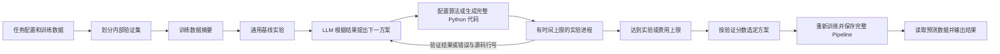

# AIAA3102 SuperAgent

目标：同一套程序接收分类任务，自主进行实验、根据内部验证结果改进、选定方案，并保存可重复运行的预测模型和完整记录。

本仓库保存源码、测试、依赖和配置模板。API 密钥、本地虚拟环境、课程原始数据、生成的演示数据及 `runs/` 运行产物不随源码上传。下文的历史实验成绩来自本地开发记录，对应模型、日志和预测文件不包含在仓库中；这些成绩也不代表当前源码已完成同一批正式测试。

首次克隆后进入仓库目录，安装 `requirements-dev.txt` 中的依赖，用 `make-demo` 或 `make-code-demo` 生成演示任务，再按下文配置本地密钥。课程任务配置 `tasks/*.json` 指向仓库外的数据路径，使用时需自行放置课程数据或调整配置中的路径。

支持 CSV 表格、单列文本、有顺序的双文本分类、独立 NPY 特征／标签文件，以及 CSV 清单引用的 RGB 图像。请使用已安装 requirements.txt 依赖的项目 .venv Python。两个已发布任务的配置在 `tasks/`。合成演示数据的分数只用于检查流程，不能作为项目正式结果。

## V2：生成 Python 代码并自动修复

新增 `llm-code` 模式。LLM 可以输出完整 Python 模块，设计自己的特征转换、组合估计器或实现自定义分类器，不再限于预置算法目录。模块提供 `build_model(X_train, y_train, seed)`，返回尚未拟合、兼容 sklearn 的估计器。程序负责调用 fit/predict、独立评分、记录结果、按验证分数选模和保存模型。

完整流程为：通用基线 → LLM 生成源码 → 单独进程训练和预测 → 主程序评分 → 把分数或错误及行号反馈给 LLM → 生成下一版完整源码。每次候选代码保存为 `experiments/trial_*/candidate.py`；失败也保留，最新完整代码会随下一次请求送回模型。重复源码按指纹识别，改名不会变成新实验。API 预算、无效回复计费和超时用量保留规则继续生效。

运行独立演示（每次用新的输出目录）：

```powershell
.\.venv\Scripts\python.exe -m superagent make-code-demo --output examples/code_demo
.\.venv\Scripts\python.exe -m superagent campaign --task examples/code_demo/tabular/task.json --planner llm-code --llm-configs config/hkust-deepseek-flash-code-json.json --budget-rmb 0.25 --output runs/my_codegen_tabular_001
```

同一入口可将任务换为 `text/task.json`、`image/task.json`，也可给 `--llm-configs` 传入已配置的三款模型。开发演示最多4次候选实验（包括1次基线），最后自动选择并保存模型。另生成的 `predict.csv` 不参与选择，可交给 `predict` 命令检查重载预测。0.25元是这个演示自行设置的费用上限。运行摘要分别记录生成尝试数、成功数和最终是否选中生成代码；基线胜出或模型主动停止均如实保留。

三款模型各新增 `*-code.json` 配置，模型、价格和校园网连接方式保持一致；回复上限改为8192 token，HTTP各阶段超时设置为360秒（不是整个请求的绝对截止时间）。真实开发检查发现旧4096上限可能耗在推理阶段，尚未输出完整代码就被截断。输出上限增加后，预算检查会按新的更大额度预留费用。历史目录 `codegen_*_001` 如实保留这些失败调用，后续各轮通过 `--previous` 继续计入原费用和未知用量预留。

Flash 另有实测的 `hkust-deepseek-flash-code-json.json`，请求 JSON 输出及 `reasoning_effort="low"`。参数依据 [DeepSeek接口说明](https://api-docs.deepseek.com/api/create-chat-completion/)；学校采用 [LiteLLM转发接口](https://docs.hpc.hkust-gz.edu.cn/docs/aigc/api-usage/)。仍需检查实际响应，JSON模式不取消源码校验、截断检测或费用记录。Pro／Qwen的新代码模式配置只做了本地校验，本轮新增真实接口检查使用 Flash。

首次克隆需要生成 `examples/code_demo/`；已经生成过时可跳过生成步骤，已有文件不会被覆盖。上面的运行命令表示首次运行的用法；继续同一任务的既有实验时，应通过 `--previous` 传入实际存在的上一轮 `campaign.json`，有未知用量时按下文说明使用开发预留模式。本地历史检查另使用了实验上限为3的 `smoke_task.json`，该文件不随仓库上传，也不是首次运行的必要文件。

生成代码接收匿名列名 `column_0`、`column_1` 等及训练标签，图像列的值是已解码的 RGB uint8 数组。验证标签只在主程序中评分，测试数据不会进入规划和选择。支持已安装的 NumPy、pandas、SciPy、sklearn、CatBoost、Pillow 及有限标准库；可定义自有转换器与分类器。单次源码上限10,000 UTF-8字节，执行有时间上限，不支持自行安装软件、联网下载权重或任意读写本地文件。

生成模型随源码和拟合状态一起保存，预测时仍在单独进程执行。自定义类无需另写可导入的模块。保存的模型要求与训练时相同的 Python 完整版本（例如3.13.5）及记录的依赖版本，不保证跨版本反序列化。训练使用本次源码快照；重载预测使用当前导入的 superagent 运行时，不会自动选择旧快照。因此精确复现时，需从对应快照启动，并保持 Python 和依赖版本一致。

**执行边界：**子进程不继承 API 密钥，配有源码检查、文件／网络／进程访问检查、时间上限与输出检查。这些是防误操作措施，**不是操作系统级安全隔离，也没有硬内存限额**；不能把恶意 Python 当成安全输入。Python 官方也明确说明 [audit hook 不是安全沙箱](https://docs.python.org/3/library/sys.html#sys.addaudithook)。当前能力面向约定输入接口的分类任务，不保证任意 unseen task 都能解决，也不代表已具备大型视觉模型或 GPU 训练能力。

V2 的检查与真实接口演示使用独立合成数据。下列课程测试成绩属于冻结的 V1，不能归到 V2；新增代码不会触发重新读取或优化已经看过的正式测试集。

完整自动检查：466项通过，1项因 Windows 无符号链接创建权限跳过。模拟接口的完整流程验证了“基线 → 代码报错 → 读取错误和原源码 → 修复 → 自动选模 → 重训 → 保存及重载预测”；训练和模型执行均使用真实子进程。检查记录在 `runs/codegen_verification/verification_runtime_final.json`，其中也核验了 V1 冻结源码和模型文件未改变。

独立合成任务的真实 Flash 开发检查记录在 `runs/codegen_development_status.json`。最后一轮 `codegen_*_004` 的结果如下；这不是课程任务成绩：

| 合成任务 | 通用基线验证准确率 | 自动选中方案验证准确率 | 生成代码执行情况 |
| --- | ---: | ---: | --- |
| 表格 | 81.67% | 96.67% | 两份生成代码均成功，选中含 SVM、KNN 和树模型的投票组合 |
| 文本 | 70.00% | 78.33% | 两份生成代码均成功，选中词／字符特征与投票分类器 |
| 图像 | 40.00% | 40.00% | 两份生成代码均失败，程序保留基线 |

图像在线失败中包含错误的 HOG 导入和执行器对 NumPy 内部操作的误拦截。后者已经修复：`runs/codegen_image_response_replay_fixed/` 原样回放之前真实接口生成的图像代码，在合成验证集达到100%，模型重载后输出15条预测及三类概率。**这是历史完整回复的执行回放，不是新的完整自主 LLM 运行**，不应覆盖在线运行的失败记录或写成图像在线流程已全部成功。在线004轮采用修复前的源码快照，最终本地检查和回放采用修复后的源码；两者指纹分别记录。回放未增加 API 调用费用。

进一步的 `runs/codegen_image_latest_replay/` 回放004轮最后一份原始代码：原始请求证明 LLM 收到 HOG 导入错误后，自行写了 HOG 特征、图像增强及 SVC 分类器。该源码与原始 trial003 文件逐字节相同，在修复后的运行器中训练、重载与15条无标签预测均成功，合成验证准确率100%。这个模型不提供概率接口；回放没有额外拟合或调用 API 来完成重载预测。它验证了模型实际生成的修复代码可运行，仍不等于重新完成一轮在线自主实验。

这次代码模式开发共36次真实 API 请求，其中33次有已知用量、3次因传输失败用量未知。按学校当前价格，已知计算费用合计 **¥0.28074750**，另保留 **¥0.06496000** 未结算请求预算；实际总费用未知，各合成任务均在0.25元开发预算内。这些费用与下文的 V1 课程任务费用分开记录，不是平台账单。表格／文本生成模型及所有自动选中的模型已完成15行无标签数据的重载预测检查。

## 冻结的 V1 结果（2026-11-14）

第三轮六次规划器运行均已结束，程序选出的两个模型已先冻结、再各做一次独立测试。优惠券三款规划器均完成8次候选实验；标题的Flash完成8次，Pro因连续无效决策提前停止，Qwen因超时留下部分结果。因此标题的三模型比较仍不完整，不能写成全部成功。

| 任务 | 自动选中的规划器／算法 | 验证准确率 | 冻结后测试准确率 |
| --- | --- | ---: | ---: |
| 优惠券 | DeepSeek Pro／直方图梯度提升树 | 75.96% | **76.94%（1952/2537）** |
| 双标题 | DeepSeek Flash／词语、字符与文体组合差分 | 69.04% | **67.79%（2191/3232）** |

冻结记录及模型在 `runs/final_release_round3/`，比较摘要和图在 `runs/round3_analysis/`；详细文件见文末。V1 的训练与评估使用同一代码指纹，当时完整自动检查327项通过。当前源码已升级到 V2，不能再声称与这批冻结模型的源码相同。测试结果不再进入选模或调参，也未因测试分数替换模型。

V1 累计已知学校价计算费用为 **¥0.49806782**，另有三笔未知用量对应 **¥0.02217728** 预留；这些不是经核验的平台账单，实际总费用仍未知。V2 合成任务的开发费用另行记录。开发无需等待用户取得账单，但正式费用合规尚未成立。仍需完成报告、AI使用声明、展示材料、V2 更广泛的未见任务评估及正式计费证据整理；项目尚未完成全部提交工作。下文首轮、第二轮和本地复核部分均为历史开发记录。

## 可行的设计

采用一个 LLM 规划器和统一实验执行器。LLM 接收训练集摘要及历史实验结果；`llm` 输出目录内的算法配置，`llm-code` 输出包含完整 Python 源码的 JSON 决策。执行器训练、验证并把结果反馈给 LLM。最终模型由程序按验证分数自动选择。



第一版通过通用算法库执行 LLM 的决定；第二版加入可执行代码生成。两种模式都不按任务名或数据集名路由到专用实现。编程能力扩大了可搜索的方案空间，但方法是否有效仍需由独立验证结果证明。

三种运行方式：

- `offline`：本地规则规划器，用来调试完整流程，无 LLM 请求、无 API 费用。输出明确标记为开发演示。
- `llm`：真实 Qwen / DeepSeek 接口规划，记录每次调用和费用。目前已配好学校的三款模型及当前学校价格；正式报告的历史官方价格另行核算。
- `llm-code`：同一计费与规划接口，生成完整代码，依据执行错误自动修复。适合继续发展为未见分类任务的通用 Agent。

## 环境与快速运行

在 PowerShell 中进入本目录。已在 Python 3.13.5 上验证依赖，建议独立虚拟环境：

```powershell
cd aiaa3102-superagent
python -m venv .venv
.\.venv\Scripts\python.exe -m pip install -r requirements-dev.txt
.\.venv\Scripts\python.exe -m superagent make-demo --output examples/demo
.\.venv\Scripts\python.exe -m superagent run --task examples/demo/tabular_task.json --planner offline --output runs/tabular_demo
.\.venv\Scripts\python.exe -m superagent run --task examples/demo/text_task.json --planner offline --output runs/text_demo
.\.venv\Scripts\python.exe -m pytest -q
```

如果当前 Python 已装好依赖，也可直接用 `python` 运行。每次运行使用新的输出目录；已有演示文件不会被覆盖。示例文件生成过后不必重新运行 `make-demo`。

## 自己的数据如何接入

新建任务 JSON，数据路径相对于该 JSON 所在目录解析：

```json
{
  "name": "my_classification_task",
  "data_type": "tabular",
  "train_path": "train.csv",
  "predict_path": "test.csv",
  "target_column": "label",
  "id_column": "sample_id",
  "metric": "f1_macro",
  "seed": 42,
  "validation_fraction": 0.2,
  "max_experiments": 4
}
```

文本任务使用 `"data_type": "text"`，并添加 `"text_column": "text"`。没有 ID 列则不写 `id_column`。`name` 只作本地记录，不传入规划器。

图像任务使用 `"data_type": "image"`、`"image_column": "image"`，可设 `"image_size": [32, 32]`（高、宽）。CSV 的 image 列保存相对于该 CSV 目录的图片路径，例如 `images/001.png`，label 列保存类别。只接受目录内相对路径；训练、验证与最终测试不可引用同一个图片文件。图片解码为 RGB 并统一尺寸，源文件指纹随运行记录保存。通用基线为网格颜色与通道统计特征加逻辑回归；`llm-code` 可生成自己的图像特征与分类器。

双文本任务使用 `"data_type": "paired_text"` 和两个有顺序的 `text_columns`。默认模型使用共享词表的 TF-IDF 差值（第一段减第二段），也可由规划器选择分槽表示。词表仅在训练数据上拟合。NPY 输入使用 `data_format="npy"`、`feature_names`、`train_labels_path` 及配套的 `validation_labels_path`；`categorical_columns` 可以显式声明类别特征。对象 NPY 和 joblib 模型仅加载可信本地文件。

## 两个课程任务与自主对比

`tasks/coupon.json` 和 `tasks/headlines.json` 都使用官方训练／验证集，指标为 accuracy，且刻意不配置测试路径。每款规划模型最多安排 8 次实验；每次运行自动选择验证集最好的候选。以下命令再自动比较三款规划模型的结果，全程不需要人工决定下一次实验或最终模型：

```powershell
python -m superagent campaign --task tasks/coupon.json --llm-configs config/hkust-deepseek-flash.json config/hkust-deepseek-pro.json config/hkust-qwen.json --output runs/coupon_round1 --budget-rmb 1
python -m superagent campaign --task tasks/headlines.json --llm-configs config/hkust-deepseek-flash.json config/hkust-deepseek-pro.json config/hkust-qwen.json --output runs/headlines_round1 --budget-rmb 1
```

`campaign.json` 保存每款规划模型的结果、累计费用和自动选中的模型路径。1 元是当前每任务开发对比自行设置的预算控制额，不是课程规定。多轮开发需通过 `--previous runs/coupon_round1/campaign.json` 继续累计费用；第三轮传第二轮的累计摘要即可。默认严格模式仍在费用不明时停止整轮。显式添加 `--development-reserves` 时，可在保留原始未知用量的同时，将经核验的传输／响应解码失败请求的原预留金额继续计入开发预算，再推进后续规划器；具体限制见下文。各轮代码变更和开发分析必须与最终冻结版本的完整自主运行区分。

方案固定后，独立评分命令只读取已保存的模型进行预测，不训练、不调用规划器、不回传测试结果：

```powershell
python -m superagent evaluate --model <自动选中的model.joblib路径> --input ../final_project_tasks/final_project_tasks/in_vehicle_coupon_recommendation/C_test.npy --labels ../final_project_tasks/final_project_tasks/in_vehicle_coupon_recommendation/y_test.npy --output runs/coupon_final_evaluation
python -m superagent evaluate --model <自动选中的model.joblib路径> --input ../final_project_tasks/final_project_tasks/headlines_ctr_clean/test.csv --output runs/headlines_final_evaluation
```

最终测试评分只应在开发迭代结束、方案固定后执行；两个任务的最终自主运行须使用同一份代码版本。评估目录独立保存预测、accuracy、混淆矩阵及文件指纹，不覆盖训练记录。

支持 `accuracy`、`balanced_accuracy`、`f1_macro`、二分类 `roc_auc`，均按越高越好选择模型。ROC AUC 使用模型 `classes_[1]` 为正类；正式任务若指定其他正类或多分类 AUC，需要先适配，不能擅自更改官方定义。

有单独的验证集时可添加 `validation_path`。没有时，从训练集内进行固定种子的分层划分。显式验证集不会进入最终重训数据；内部划分时，选定方案后在原训练集上重新训练。当前随机分层方式不适用于需要按时间或分组划分的任务，须按课程任务要求扩展。

`predict_path` 只在模型选择结束后读取，不把其中的标签用于任何训练、调参或指标计算。普通运行输出标签与概率文件；独立 evaluate 命令用于方案固定后的测试评分。预处理随模型一起保存；先划分数据，再在训练部分拟合预处理，是避免泄漏的基本做法，参见 [scikit-learn 官方说明](https://scikit-learn.org/stable/common_pitfalls.html#data-leakage)。

## 接入真实 LLM

按用户要求，已根据 [学校调用说明](https://docs.hpc.hkust-gz.edu.cn/docs/aigc/api-usage/) 接入 V2：

`https://aigc-api.hkust-gz.edu.cn/api/v2/chat/completions`

三款配置均使用 `Authorization: Bearer` 鉴权，从 `AIGC_API_KEY` 读取密钥。学校使用 LiteLLM 代理；这些配置默认通过提示要求 JSON，再由本地严格校验，不依赖学校文档没有保证的 `response_format` 参数。通信失败或费用未知时停止当前规划器运行，不自动重试该请求或切换协议；开发预留模式只能另行推进后续规划器。完整实验收到无效决策时，可能在预算和尝试次数限制内重新请求，每次都记账；`check-api` 连通检查始终只发送一次请求。

下列价格来自 [学校当前列表](https://docs.hpc.hkust-gz.edu.cn/docs/aigc/api-model-list/)，记录日期为 **2026-11-14**，单位是人民币元／百万 token：

| 配置文件 | 请求模型 | 输入价格 | 输出价格 |
| --- | --- | ---: | ---: |
| `config/hkust-deepseek-flash.json` | `DeepSeek-V4.1-Flash` | 0.50 | 2.00 |
| `config/hkust-deepseek-pro.json` | `DeepSeek-V4-Pro` | 2.25 | 6.75 |
| `config/hkust-qwen.json` | `Qwen3.8-27B` | 0.10 | 0.34 |

学校明确列出的后端名称 `DeepSeek-V4.1-Flash-1017` 和 `Qwen3.8-27B-w8a8` 已加入对应配置的返回名称列表。Pro 只接受学校明确公布的 `DeepSeek-V4-Pro`。返回其他名称时会保留响应、停止调用，核对映射后再使用；不会猜测未知模型的价格。

真实接口测试发现，学校 Qwen 会将思考前缀与最终 JSON 一起放入 `content`，以 `</think>` 分隔。因此只有 Qwen 配置启用 `content_parser="qwen_think_json"`：有分隔符时，只把其后的完整文本作为 JSON 校验；没有分隔符时仍接受纯 JSON。原始响应完整保留在调用日志中，不从思考内容中猜测或提取候选方案。

三份配置供同一套 Agent 使用：run 运行一款规划模型，campaign 依次比较三款模型，自动按验证分数选择最终方案。

### 校园网直连与境外代理共存

2026-11-14 的本机排查确认：无线网卡连在校园网，但使用公共 DNS，且 Windows 启用了 Clash 系统代理。校园网 DHCP 提供的 DNS `10.90.63.2`、`10.90.63.3` 均将 `aigc-api.hkust-gz.edu.cn` 解析为 `10.121.10.250`；绕过代理连接这个地址时，HTTPS 证书校验成功。

三份学校配置现设置 `bypass_system_proxy=true` 和 `connect_ip="10.121.10.250"`，只让本项目的学校 API 请求绕过系统代理、连接已核对的校内地址。HTTPS 的 Host、SNI 和证书校验仍使用原域名，没有关闭证书验证，也没有更改系统 DNS、hosts、Clash 或其他应用设置。实现采用 [HTTPX 官方支持的 SNI 扩展](https://www.python-httpx.org/advanced/extensions/#sni_hostname)。

该设置依赖当前校园网络能路由到校内地址；它不会绕过操作系统级的全流量 VPN/TUN。若学校更换 API 地址，需重新向校园 DNS 核对并更新 `connect_ip`；需要恢复普通域名访问时，把 `connect_ip` 改为 null。`bypass_system_proxy=false` 则恢复读取系统代理。非学校配置默认保留原有网络行为。

### 本地设置密钥

打开本目录 `.env.local`，将密钥填在 `AIGC_API_KEY=` 后面并保存；如果文件不存在，先复制 `.env.example`。也可在启动 Python 的同一终端设置 `AIGC_API_KEY` 环境变量，环境变量优先。不要把密钥发到聊天、放进任务配置或提交给课程。`.env.local` 已被忽略，运行快照也不收集它。

先做不联网的配置检查，再做一次小额 API 检查：

```powershell
python -m superagent check-config --llm-config config/hkust-deepseek-flash.json
python -m superagent check-api --llm-config config/hkust-deepseek-flash.json --output runs/check_flash_001
python -m superagent check-api --llm-config config/hkust-deepseek-pro.json --output runs/check_pro_001
python -m superagent check-api --llm-config config/hkust-qwen.json --output runs/check_qwen_001
```

`check-config` 只显示配置是否有效、密钥是否存在，不显示密钥。`check-api` 每次只发送一条简单 JSON 响应请求，不读取任务数据，默认预算上限为 **0.10 元／次检查**，可用 `--max-cost-rmb` 调低。仍采用保守预留，服务端若违背预留上限会记录实际消耗并停止。成功与失败均记录于该输出目录的 `api_check.json`、`llm_calls.jsonl` 和 `usage_summary.json`；缺少密钥时不会发出请求。

然后运行真实规划器：

```powershell
python -m superagent run --task examples/demo/tabular_task.json --planner llm --llm-config config/hkust-deepseek-flash.json --output runs/llm_flash_001
```

将 `--llm-config` 换成其他两份配置即可选用 Pro 或 Qwen，每次使用新的输出目录。完整实验的配置预算目前为 20 元，按选定计费口径计算。

### 学校费用与课程费用的区别

当前三份学校配置使用 `pricing_basis="provider_current"`，表示按用户指定的学校当前价格计算开发费用。日志会标明价格、日期、来源，并设置 `course_pricing_compliant=false`：这不是课程要求的 2026-10-21 官方标准价。`calculated_cost_rmb` 是根据 token 和配置价格计算的金额，`provider_billed_cost_rmb` 为 null，因为程序没有读取平台账单；兼容字段 `accounted_cost_rmb` 表示同一计算金额。

正式报告前，需要根据已保留的每次请求模型版本与 token 用量按官方历史价格重新核算，并确认每个任务仍满足 20 元限额；有历史日志并不意味着重新核算后一定合规。

`config/llm.example.json` 保留 `pricing_basis="official_standard"` 模板。该模式仍要求 `pricing_as_of="2026-10-21"`。核对完整来源后才能填写 `verified=true`；这个字段是对配置来源的确认，不能自动证明历史价格或服务端实际权重版本。

每次请求先检查预算并预留费用，再按实际用量结算。缓存 token 按所选配置的普通输入价格计费。未知用量、零输入 token 占位记录、模型身份不匹配或网络超时会停止调用并留下未结算记录，不能当成零成本。训练超时保留失败记录，允许规划器依据反馈继续。

课程预算是每个正式评测任务人民币 20 元。单独 run 命令按输出目录记账；campaign 命令汇总三款模型，并通过 --previous 延续前轮累计费用。正式任务应冻结版本后完整自主运行，如实说明开发重复尝试的用途与费用，不能通过新建目录规避限额。

## 每次运行会留下什么

| 文件 | 作用 |
| --- | --- |
| `model.joblib` | 完整预处理、分类模型及预测所需配置 |
| `predictions.csv` | ID（如果配置）与预测标签 |
| `predictions_probabilities.csv` | 类别概率，列顺序在摘要中记录 |
| `summary.json` | 运行状态、最佳验证分数、选中方案、费用与限制 |
| `events.jsonl` | 决策、实验、选择、重训及预测的时间顺序 |
| `experiments.jsonl` | 每个候选方案的结果或失败情况 |
| `experiments/trial_*/` | 单次实验配置、标准输出、错误日志和模型 |
| `llm_calls.jsonl` | 真实模式每次请求、响应、token 与费用记录 |
| `usage_summary.json` | 费用及未结算状态 |
| `llm_config.snapshot.json` | 真实模式的非敏感接口、模型与计费配置快照 |
| `task_snapshot.json` | 本次任务参数与解析后的数据路径 |
| `split_manifest.json` | 训练和验证划分记录 |
| `data_profile.json` | 仅根据训练部分生成的数据摘要 |
| `manifest.json` / `source_snapshot/` | 数据指纹、源代码指纹、代码快照与依赖版本 |

实验子进程执行本次保存的代码快照。每轮实验默认最多 120 秒，最终重训默认 240 秒，可用 `--experiment-timeout`、`--refit-timeout` 调整。此限制是第一版的运行保护，不是课程指定的训练时间限制；目前没有独立的内存/GPU资源限制。

如果最终重训失败，会保存验证阶段选中的可用模型，并在摘要中标注部分结果。不能把此时的模型描述为已经完成全训练集重训。

摘要单独列出 `llm_requests`、`valid_llm_decisions` 和 `accounting_complete`，不会把仅跑基线或只收到无效响应的运行冒充有效 LLM 实验。campaign 只从至少有一次有效 LLM 决策、当前运行核算完整且未被阻断的合格完成结果中选模。未知费用对应 `partial_unresolved_accounting`，服务端超出预留限制对应 `partial_accounting_limits_violated`；单次 run 在这两种情况下返回退出码 2，保留已有模型用于排查和部分结果说明。

重新加载本项目生成的可信模型进行预测：

```powershell
python -m superagent predict --model runs/tabular_demo/model.joblib --input examples/demo/tabular_predict.csv --output runs/reloaded_predictions.csv
```

## 剩余提交工作

1. 整理报告：解释设计、候选实验、失败恢复、部分比较结果、冻结后的测试表现与局限。
2. 补齐AI工具使用声明和展示材料，并由组员核验可复现入口及模型文件。
3. 整理课程要求的官方历史价格和真实用量证据；三笔未知用量继续保留，不能据预留金额宣称正式费用合规。
4. 评估未见任务支持范围；V2 已有图像适配器与代码生成能力，图像仍需补充完整在线自主运行验证。已完成的测试结果不得用于修改本次冻结模型或继续调参。

## AI 工具使用记录（开发阶段，待组员核对）

本项目起始框架由 Codex 协助设计、编码、编写文档和测试。运行时 LLM 的调用记录与开发辅助工具使用记录是两回事。提交前需要补充组员实际使用过的工具、用途和人工核验过程，并确认每位组员理解源码、实验和局限。本段是开发记录，不替代完整的最终声明。

## 正式数据首轮开发记录（历史，2026-11-14）

两任务第一轮均由 DeepSeek-V4.1-Flash 自动完成 8 次实验，使用课程指定验证集，未读取测试集。

| 任务 | 通用基线验证准确率 | 第一轮最佳验证准确率 | 最佳方案 | 学校价计算费用 |
| --- | ---: | ---: | --- | ---: |
| 优惠券 | 66.40% | 75.81% | 随机森林，400棵树，深度30 | ¥0.0104015 |
| 双标题 | 68.09% | 68.94% | 字符2–5 gram差分，50000特征 | ¥0.012078 |

原始记录分别在 `runs/coupon_pilot_001`、`runs/headlines_pilot_001`。第一轮同一代码指纹为 `1082b6f57f6348dc75793fc7204e4f336608e3f2a0d6d56dba7a185fcf73e43e`。词级双词组和分槽表示在标题任务中未优于初始基线，随后字符差分有所改善；优惠券的非线性模型明显优于线性基线。因此第二轮扩展通用候选库，而不是按数据集名称编写专用解法。

第二轮完整命令使用 `campaign`，分别传入 `--previous runs/coupon_pilot_001/summary.json` 和 `--previous runs/headlines_pilot_001/summary.json`，输出为 `runs/coupon_round2` 与 `runs/headlines_round2`。每任务累计开发上限1元包含首轮费用；不把不同版本的候选直接混合作最终选模。

## 第二轮结果与恢复过程（历史，2026-11-14，第三轮前）

截至第二轮结束，两个任务合计完成 34 次训练实验、52 次 API 请求。准确率均为验证集结果，当时正式测试集尚未读取。

| 任务／规划器 | 训练次数 | 最佳验证准确率 | 状态 |
| --- | ---: | ---: | --- |
| 优惠券／Flash | 8 | 76.40% | 完成；类别提升树优于首轮75.81% |
| 优惠券／Pro | 2 | 75.52% | 旧规划循环收到22次无效JSON；已计费并保留记录 |
| 优惠券／Qwen | 1 | 66.40% | 仅通用基线完成，首次API超时，不能视作Qwen有效对比结果 |
| 标题／Flash | 7 | 68.94% | 新组合特征持平首轮最佳；末次API超时 |
| 标题／Pro、Qwen | 0 | — | 第二轮未启动，当时的严格累计计费检查在未知用量后停止 |

第二轮结束时，两个任务连同首轮已知学校价计算费用为 **¥0.20081575**；另有两次未返回 token 的请求，保留 **¥0.01918464** 的预算预留。预留值不是实际费用，总账仍未核清。未核清调用为北京时间2026-11-14 04:12:50的Flash、04:14:20的Qwen。用户已确认只有推理 API Key，无法查看平台账单；该信息不证明请求未执行，未知 token 和费用继续保留为 null。开发流程改用显式预留模式继续，账单不再是开发实验的前置条件。

修复后的程序会向下一次请求反馈安全的JSON错误提示，连续3次无效决策后停止。默认严格模式拒绝承接未完成或计费被阻断的旧运行；显式开发预留模式仅允许经原始日志核验的传输／解码失败继续占用预留后推进，模型身份不匹配、无效用量和超出预留限制仍会阻断。学校配置等待上限由60秒延长到180秒，不自动重试超时请求。旧运行快照与费用日志没有被改写；第三轮结果以各自新输出目录为准。

机器可读总记录：`runs/development_status.json`。早期验证进展图：`runs/development_progress.png`。首轮误差分析：`runs/pilot_validation_analysis/`。当时计划在每任务1元开发预算控制额内继续比较，再冻结模型并独立评分；第三轮及冻结后测试现已结束，终态与结果见文末，不能把这里的历史记录当作最终结果。

此前只读排查已找到平台自己的 My Logs 接口 `/api/log/getMineChatLogList`，但现有推理 API Key 得到应用层401，需要管理账号登录权限。该次排查没有尝试绕过登录，也没有发送新的付费模型请求。诊断记录在 `runs/usage_lookup_diagnostic.json`。

## 不调用 API 的本地复核（历史，2026-11-14，第三轮前）

为继续推进开发而不掩盖待核账调用，又完成了8次固定候选对照和6次训练集内部交叉验证。所有实验均未读取测试集，不产生新的学校API费用，也不能作为最终自主LLM实验结果。

优惠券：新增通用 CatBoost 后端，按训练列类型处理类别、数值和缺失值，使用CPU单线程且不使用验证集早停。其类别处理方式见 [CatBoost 官方说明](https://catboost.ai/docs/en/features/categorical-features)。固定的三种配置验证准确率为74.43%、75.22%、74.14%；原直方图提升树对照精确复现76.40%，因此不替换现有开发参照。对照模型保存重载后，预测及概率与先前LLM选出的模型完全一致。记录在 `runs/coupon_local_study_001/`。

标题：强正则化且关闭文体特征的组合模型在官方验证集为69.26%，比字符对照68.94%只多答对3条。随后仅在8301条训练数据内对这两个固定候选做3折复核：字符模型平均68.28%，组合模型67.11%，字符模型三折均胜出。因而不将3条样本的差异认定为可靠改进；这次交叉验证是已选候选的稳健性分析，也不是新的独立测试集。记录在 `runs/headlines_local_study_001/train_cv/`。

运行器随后增加了每个候选的训练分数，以及训练分数减验证分数的差距，并把这些汇总指标反馈给LLM，让后续自主规划能够识别过拟合。模型最终选择仍以指定验证指标为依据，不按训练分数选模。

## 开发预留模式与恢复记录（2026-11-14）

用户无法取得账单，因此已将“核账后才能继续开发”的旧阻塞状态改为显式开发预留模式。默认严格模式未改变。以下是当时承接第二轮的命令示例，说明必须保留 `--previous`，避免遗漏首轮、失败决策及其他已知费用；当前冻结版本已完成测试，不据测试结果重新启动选模或调参：

```powershell
.venv/Scripts/python.exe -m superagent campaign --task tasks/coupon.json --llm-configs config/hkust-deepseek-flash.json config/hkust-deepseek-pro.json config/hkust-qwen.json --previous runs/coupon_round2/campaign.json --output runs/coupon_development_next --budget-rmb 1 --development-reserves
.venv/Scripts/python.exe -m superagent campaign --task tasks/headlines.json --llm-configs config/hkust-deepseek-flash.json config/hkust-deepseek-pro.json config/hkust-qwen.json --previous runs/headlines_round2/campaign.json --output runs/headlines_development_next --budget-rmb 1 --development-reserves
```

每个任务按“已知学校价计算费用＋所有未核清请求的原预留”控制剩余开发额度。第二轮后，优惠券已知费用¥0.17861275、未知预留¥0.00299264；标题已知费用¥0.022203、未知预留¥0.016192。预留只是保守规划金额，既不是实际收费，也不是服务端收费的保证上限，因此不能据此宣称实际总费用已确定或必然低于1元。

原调用日志、未知 token 和费用均不改写。只要仍有未核清请求，累计 `accounting_complete=false`，`formal_evaluation_eligible=false`；后续成功调用不会清除它们。`budget_committed_rmb` 单独记录已知费用加预留，`cumulative_cost_rmb` 只累计已知计算费用。模型身份不明、缺失／无效用量、预留或预算限制违规仍会停止；新的超时会停止当前规划器运行，经核验并计入原预留后才可继续下一个规划器。

开发预留模式可将所有计划中的运行完成且只剩历史未知费用的比较记为 `development_completed_unresolved_accounting`。如果新一轮也有运行未完成，则记为 `development_partial_unresolved_accounting`。这两种状态都不代表核账完成，也不表示课程费用合规。官方测试集在统一代码版本和最终模型冻结前保持封存；本次已按此顺序完成一次独立测试，结果不再用于开发决策。

此前283项完整检查及66项针对性检查属于旧版本的历史验证记录。当前源代码的完整检查结果为327项通过；历史数量不与当前数量叠加。

### 将来取得真实核账证据时

已提供 `reconcile-usage` 入口。`runs/reconciliation_pending_templates/flash.json` 和 `qwen.json` 已填好原始调用身份与文件指纹；未知用量仍为null，模板本身不能通过导入。只有取得真实平台记录或明确的未执行确认后，才能补齐来源与token用量。不能把预算预留当作实际扣费，也不能因查不到记录就填0。

```powershell
.venv/Scripts/python.exe -m superagent reconcile-usage --run runs/headlines_round2/planner_01 --evidence runs/reconciliation_pending_templates/flash.json --output runs/reconciled_flash_001
.venv/Scripts/python.exe -m superagent reconcile-usage --run runs/coupon_round2/planner_03 --evidence runs/reconciliation_pending_templates/qwen.json --output runs/reconciled_qwen_001
```

核账输出独立记录，不修改原始调用日志或把旧训练改成成功。对于兼容的旧式 `completed`／`partial_accounting` campaign，可以将原先的 `--previous .../campaign.json` 与 `--reconciliations .../reconciliation.json` 一起传入，重新核验原账本、配置、证据与费用计算。本轮 `development_*` campaign 暂不直接支持严格模式承接；将来取得的费用证据仍可独立保存。本轮模型已经固定，核账不触发重新训练或选模。

没有真实证据时不填写核账模板，不将预留替换为 token 或实际费用。默认严格模式仍会在发出新请求前拒绝未核清历史；只有显式开发预留模式允许在保留未知状态和累计预算占用的前提下推进实验。上述两份模板对应第二轮；第三轮新增的一笔未知请求也继续保留原始记录。若以后取得有效证据，再使用独立核账记录更新计算，不改写历史训练结果。

## 第三轮终态与冻结后的独立测试（2026-11-14）

第三轮六次规划器运行使用同一源代码指纹 `0116009cd25c4c0d3cbe109b071145bda946f811f5ee387e3d8f31a3e61dc06b`，期间没有修改代码或人工指定下一次候选。程序只根据本轮验证结果选模，没有把旧轮分数更高的模型人工替换进来。

| 任务／规划器 | 候选实验数 | 本轮最佳验证准确率 | 运行终态 |
| --- | ---: | ---: | --- |
| 优惠券／Flash | 8 | 75.47% | 完成 |
| 优惠券／Pro | 8 | 75.96% | 完成，自动选中 |
| 优惠券／Qwen | 8 | 74.43% | 完成 |
| 双标题／Flash | 8 | 69.04% | 完成，自动选中 |
| 双标题／Pro | 2 | 68.09% | 部分比较：1次有效决策、4次无效决策，最后连续3次无效后停止 |
| 双标题／Qwen | 2 | 68.09% | 部分比较：1次有效决策，下一请求180秒后ReadTimeout，费用未知 |

标题Pro的运行摘要为 `completed_with_warnings`，表示保存了成功候选和警告，不能据此称其完成了8次实验；Qwen为 `partial_unresolved_accounting`。优惠券campaign为 `development_completed_unresolved_accounting`，标题为 `development_partial_unresolved_accounting`，历史未知费用均保留。比较图与可追溯摘要分别在 `runs/round3_analysis/comparison.png`、`runs/round3_analysis/summary.json`。

第三轮合计36次候选实验、35次API请求，其中34次有用量、1次未知，另记录4次无效决策。连同首轮和第二轮，课程数据开发共70次候选实验、87次API请求（84次有用量、3次未知）；另有14次本地／交叉验证训练，合计84次候选及本地训练，不包含最终重训。无效响应的已知消耗全部计入费用。

| 任务 | 累计已知学校价计算费用 | 未知调用预留 | 开发预算占用（已知＋预留） |
| --- | ---: | ---: | ---: |
| 优惠券 | ¥0.31981403 | ¥0.00299264 | ¥0.32280667 |
| 双标题 | ¥0.17825379 | ¥0.01918464 | ¥0.19743843 |
| 合计 | **¥0.49806782** | **¥0.02217728** | **¥0.52024510** |

每任务预算占用低于设置的1元开发控制额，但预留不是实际收费或服务端收费的保证上限。三笔未知调用的 token 和实际费用仍为null；学校当前价也不是课程要求的历史官方价，因此不宣称实际账单总额或课程费用合规。

程序选出的模型于北京时间2026-11-14 13:39冻结，随后各执行一次独立测试；评估阶段没有训练或规划器调用。训练与评估代码指纹一致，模型文件指纹与冻结记录一致。

| 任务 | 冻结方案 | 验证准确率 | 测试准确率 | 正确／总样本 |
| --- | --- | ---: | ---: | ---: |
| 优惠券 | Pro规划的直方图梯度提升树 | 75.9606% | 76.9413% | 1952／2537 |
| 双标题 | Flash规划的词语、字符与文体组合差分 | 69.0426% | 67.7908% | 2191／3232 |

测试结果仅用于报告已冻结模型的表现；不据此修改参数、继续选模或更换最终模型。标题的部分比较和计费未知仍需在报告中披露。

发布目录为 `runs/final_release_round3/`，关键文件如下；这里只列评估元数据和输出位置，不需要再次读取测试集来查看结果。

| 文件（相对于发布目录） | 内容 |
| --- | --- |
| `freeze.json` | 测试前冻结时间、代码及模型指纹、自动选择依据 |
| `results.json` | 两项任务的结果与费用说明汇总 |
| `verification.json` | 冻结先于测试、模型未改变、预测数量和概率检查 |
| `source/` | 与两项测试模型对应的冻结源码和依赖清单 |
| `models/coupon/model.joblib` | 优惠券完整预测模型 |
| `models/headlines/model.joblib` | 双标题完整预测模型 |
| `evaluation_coupon/summary.json` | 优惠券测试指标及运行元数据 |
| `evaluation_headlines/summary.json` | 双标题测试指标及运行元数据 |
| `evaluation_coupon/predictions.csv` | 优惠券测试预测 |
| `evaluation_headlines/predictions.csv` | 双标题测试预测 |

两个评估目录还保存 `predictions_probabilities.csv` 和 `manifest.json`。这些输出完成了本次冻结版本的测试环节；报告、AI声明、展示、未见任务支持与正式计费证据仍待整理。
